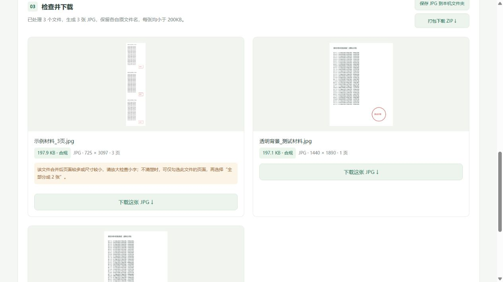

<div align="center">

# 📎 报名材料处理工具

### 大扫描件进来，合规小图片出去。

**PDF / JPG / PNG → 小于 200KB 的 JPG**

一文件一张图 · 保留原文件名 · 多页合并 · 本机处理


[](LICENSE)

[快速开始](#-快速开始) · [使用方法](#-三步把材料准备好) · [输出模式](#-四种输出方式) · [常见问题](#-常见问题)

</div>

---

## 😵 材料都准备好了，却卡在“文件过大”？

报名系统的一句 **“只允许 JPG / PNG，单张不超过 200KB”**，往往意味着：

- 学籍报告是 PDF，系统却只收图片。
- 毕业证拍得很清楚，一看大小却有好几 MB。
- 批量压缩完，文件都变成了统一名称，还得一张张找。
- 同一份 PDF 有好几页，需要合并，又怕把其他材料混进去。

这个小工具就是为这些时刻准备的。**把文件拖进来，选好模式，检查预览，再带着原来的文件名保存出去。**

```text
导入                                     默认输出
──────────────────────────────────────────────────────
学籍报告.pdf（3 页）       ───────────→    学籍报告.jpg
毕业证.JPG                ───────────→    毕业证.jpg
成绩单.png                ───────────→    成绩单.jpg

                   3 个文件 → 3 张 JPG
                   每张均小于 200KB
```

> 📌 这是独立的本地文件工具，与任何招聘机构或报名平台无隶属关系。请以你实际报名页面的要求为准。

## ✨ 它能做什么？

| 你想做的事 | 工具怎么处理 |
| --- | --- |
| PDF 转图片 | 渲染 PDF 的可见页面，再生成 JPG |
| 批量压缩图片 | 支持 JPG、JPEG、PNG，一次导入多个文件 |
| 输入几个文件，输出几张图 | 默认按原文件分组；一个多页 PDF 也只生成它自己的那一张图 |
| 保留材料名称 | `成绩单.png` 输出 `成绩单.jpg`；同名结果自动追加编号 |
| 把多份证明拼起来 | 可全部合并为 1 张，或按顺序分成 2 张 |
| 调整页面 | 勾选、移除、前后排序、顺时针旋转 |
| 选择排版和色彩 | 上下排列 / 双列排列，保留彩色 / 黑白灰度 |
| 找到最终文件 | 单张下载、打包 ZIP，或直接保存到本机文件夹 |
| 确认文件大小 | 服务端校验真实字节数，网页再次检查接收到的 JPG 大小 |

## 🖼️ 先看一眼



*截图全部使用虚构测试材料。示例导入 3 个文件、共 5 页，默认生成 3 张保留原名的 JPG。*

## 🚀 快速开始

需要 **Python 3.10 或更高版本**。Windows 可以双击启动；其他系统可通过终端启动本地网页。

### 1. 获取项目

```bash
git clone https://github.com/yinongkeji01/Application-material-processing-tool.git
cd Application-material-processing-tool
```

也可以在 GitHub 点击 **Code → Download ZIP**，解压后进入项目文件夹。

### 2. 安装依赖

**Windows（PowerShell 或命令提示符）：**

```powershell
py -3 -m venv .venv
.venv\Scripts\python.exe -m pip install -r requirements.txt
```

如果你的电脑使用 `python` 而不是 `py`，第一行改为 `python -m venv .venv`。

**macOS / Linux：**

```bash
python3 -m venv .venv
.venv/bin/python -m pip install -r requirements.txt
```

首次安装依赖需要联网；安装完成后，**材料转换不需要联网**，也不依赖在线压缩服务。

### 3. 启动工具

**Windows：双击项目根目录的 `启动材料压缩工具.bat`。**

启动器优先使用项目的 `.venv` 环境，随后检查系统 Python，浏览器会自动打开本机工具页面。

也可以直接运行：

```powershell
.venv\Scripts\python.exe 材料压缩工具\server.py
```

**macOS / Linux：**

```bash
.venv/bin/python 材料压缩工具/server.py
```

终端会显示类似 `http://127.0.0.1:端口号` 的地址。如果浏览器没有自动打开，复制这个地址访问即可。

<details>
<summary>需要指定端口，或不自动打开浏览器？</summary>

```bash
python 材料压缩工具/server.py --port 18976 --no-browser
```

未指定端口时，程序会由系统分配空闲端口。服务始终绑定 `127.0.0.1`，只供本机访问。

</details>

## 🧭 三步把材料准备好

### ① 导入

点击或拖入 PDF、JPG、PNG，可以多选。PDF 自动显示为多个页面，原始文件不会被修改。

### ② 生成

大多数批量场景，保持默认的 **“按原文件批量输出”** 即可。需要拼接不同文件时，再选择其他合并模式。

点击 **“生成合规 JPG”**，等待处理完成。页面会显示每张图片的实际大小、尺寸和包含页数。

### ③ 检查并保存

点击结果图片查看实际像素预览，重点检查小字、姓名、日期、印章和页面边缘。

- **保存 JPG 到本机文件夹**：写入 `材料压缩工具/导出结果/时间戳-随机编号/`，每次保存使用独立目录。
- **下载这张 JPG**：通过浏览器保存单张图片。
- **打包下载 ZIP**：一次带走所有结果；上传报名系统前请先解压。

“打开文件夹”按钮目前适用于 Windows；其他系统请按照页面显示的路径查找结果。

> ✅ 上传的是生成的 **`.jpg` 文件**。ZIP 只用于集中下载，不能代替图片上传。

## 🧩 四种输出方式

| 模式 | 输出数量 | 文件名 | 适合什么情况 |
| --- | --- | --- | --- |
| **按原文件批量输出（默认）** | 每个被选中的原文件 1 张 | 保留原名，扩展名改为 `.jpg` | 一次处理学籍报告、毕业证、成绩单等不同材料 |
| 全部合并为 1 张 | 所选页面共 1 张 | 可填写统一名称，留空自动命名 | 需要把多个证明拼成一张 |
| 全部分成 2 张 | 所选页面共 1～2 张 | 统一名称，必要时追加序号 | 同一类材料最多允许上传两张 |
| 每页单独输出 | 每个被选中的页面 1 张 | 保留原名，多页 PDF 追加真实页码 | 需要拆开 PDF 的每一页 |

**几个容易搞混的细节：**

- 默认模式以“每次导入的原文件”为分组依据，不会把名字相同的两个文件混成一组。
- 原文件同名，或 `.pdf`、`.png` 转换后恰好重名时，会得到 `证明.jpg`、`证明 (2).jpg` 等结果。
- 勾选部分页面后，只处理被选中的页面；同一文件内的合并顺序以页面列表为准。
- 拆分某个 PDF 时，先只勾选它的页面，再选择“全部分成 2 张”，避免把其他材料也拼进去。
- 批量输出超过两张并不代表不能上传：**数量限制通常按材料类别计算**，请按报名系统的栏目分别上传。

## 🔒 文件留在你的电脑上

```text
浏览器选择文件
      ↓ 仅传到本机 127.0.0.1
Python 在内存中渲染、排版、压缩
      ↓
本机预览 → 浏览器下载 / 你主动保存到文件夹
```

- 不调用云端转换、OCR、AI 或第三方上传接口。
- 界面资源均随项目提供，运行时没有外部 CDN、统计或广告脚本。
- 原文件不落入工具的临时上传目录；仅当你点击保存或下载时，才会写出结果。
- 点击页面底部 **“退出工具”** 会停止本地服务，并释放工具持有的本次处理数据。已保存的结果仍由你保留。
- **关闭网页不会自动停止后台服务。**

仓库的 `.gitignore` 默认忽略 PDF、普通图片、ZIP、导出目录和临时目录，只放行文档示例图，降低误提交个人材料的概率。

## 📏 关于 200KB，也关于清晰度

输出必须 **严格小于 `199,000` 字节**，兼容把 200KB 按 `200,000` 或 `204,800` 字节计算的平台。结果页面按 `1KB = 1,000 字节` 显示大小。

压缩时先尝试适中的 JPG 质量；超出大小后再逐步缩小尺寸，找到可容纳的尺寸后，提高到满足限制的较高质量。**最终是否合规，看实际生成文件的字节数。**

但 200KB 并不能无限装下清晰的页面。**大小合规 ≠ 小字一定可读。** 多页材料尤其需要检查原尺寸预览；不够清楚时，减少合并页数或分成两张。证件和印章建议保留彩色。

| 当前边界 | 说明 |
| --- | --- |
| 输入类型 | PDF、JPG / JPEG、PNG |
| 输出类型 | JPG；目前不输出 PNG 或 PDF |
| 单文件大小 | 接受不超过 80MiB（`80 × 1024 × 1024` 字节）的文件 |
| 一次导入页数 | 最多 30 页，所有文件合计 |
| 密码保护 PDF | 暂不支持，请先自行解除密码保护 |
| 图片处理 | 支持 EXIF 方向修正、透明背景转白底 |
| PDF 内容 | 渲染可见页面；不保留文字层、交互表单或数字签名验证能力 |
| 部署方式 | 为单机个人使用设计，不是多用户公网服务 |

## 🛠️ 给想继续完善它的你

项目使用 **Python 标准库 HTTP 服务 + Pillow + PyMuPDF + 原生 HTML / CSS / JavaScript**。无需 Node.js，也没有前端构建步骤。

```text
Application-material-processing-tool/
├── README.md
├── LICENSE
├── requirements.txt
├── 启动材料压缩工具.bat
├── 材料压缩工具/
│   ├── processor.py       # 导入、页面渲染、合并、压缩
│   ├── server.py          # 本机接口、命名、保存与下载
│   ├── index.html        # 操作界面
│   ├── app.js            # 页面选择、预览与交互
│   ├── style.css         # 响应式样式
│   ├── 启动工具.ps1       # Windows 通用启动器
│   ├── requirements.txt
│   ├── 使用说明.txt
│   └── test_tool.py      # 使用虚构数据的回归测试
├── docs/images/          # 仅含虚构材料的界面示例
└── .github/workflows/    # Windows / Linux 自动化测试配置
```

### 运行测试

在已安装依赖的环境中：

```bash
cd 材料压缩工具
python -m unittest -v test_tool
```

测试覆盖大小限制、多页 PDF、透明背景、EXIF 方向、原文件分组与命名、同名防覆盖、页码、ZIP、本机保存，以及本机接口访问校验。

Windows 启动脚本需要保留 **CRLF 换行**；PowerShell 文件使用 **UTF-8 BOM**。仓库已用 `.gitattributes` 固定脚本换行格式，避免启动命令被截断。

欢迎提交 [Issue](https://github.com/yinongkeji01/Application-material-processing-tool/issues) 或 Pull Request。复现问题时，请使用虚构或已脱敏的示例，**不要上传真实证件、学籍报告或个人报名材料**。

## ❓ 常见问题

<details>
<summary><b>已经压到 200KB 以下，为什么小字还是不清楚？</b></summary>

通常是原文件本身模糊，或一张图片合并了太多页。试着减少页数、拆成两张，并检查原尺寸预览。继续压缩无法恢复原图中已经丢失的细节。

</details>

<details>
<summary><b>为什么输入 PNG，输出却是 JPG？</b></summary>

工具面向允许 JPG / PNG、且文件大小很小的上传场景，目前统一输出 JPG，以便在文件大小和可读性之间取得实用的平衡。透明区域会填充为白色。

</details>

<details>
<summary><b>启动时提示找不到 Python 或依赖？</b></summary>

先完成上面的虚拟环境和依赖安装步骤。Windows 启动器会优先检查项目根目录下的 `.venv`，也可以使用终端直接运行 `server.py` 查看错误。

</details>

<details>
<summary><b>更新后只刷新网页就可以了吗？</b></summary>

涉及 Python 服务更新时，需要先点击旧页面的“退出工具”，再重新启动并导入原文件。原始材料不会被修改；此前保存的 JPG 也不会被删除。

</details>

<details>
<summary><b>这个工具能保证通过所有报名系统审核吗？</b></summary>

不能。它处理格式、大小、命名与排版；材料内容、有效期、盖章和平台可能另设的像素要求，仍需按实际报名页面检查。

</details>

## 📜 开源许可与致谢

本项目采用 **[GNU AGPL-3.0](LICENSE)** 开源。依赖 [PyMuPDF](https://pymupdf.readthedocs.io/en/latest/about.html#license-and-copyright) 提供 PDF 渲染，依赖 [Pillow](https://python-pillow.github.io/) 提供图片处理。各依赖保留其原有版权和许可；PyMuPDF 同时提供 AGPL 与商业许可选项，具体以其官方说明为准。

---

<div align="center">

**愿你把时间花在准备机会，而不是反复调整文件大小。** 🍀

如果这个小工具帮到了你，欢迎点一颗 ⭐，也欢迎把它分享给正在准备报名材料的朋友。

</div>
